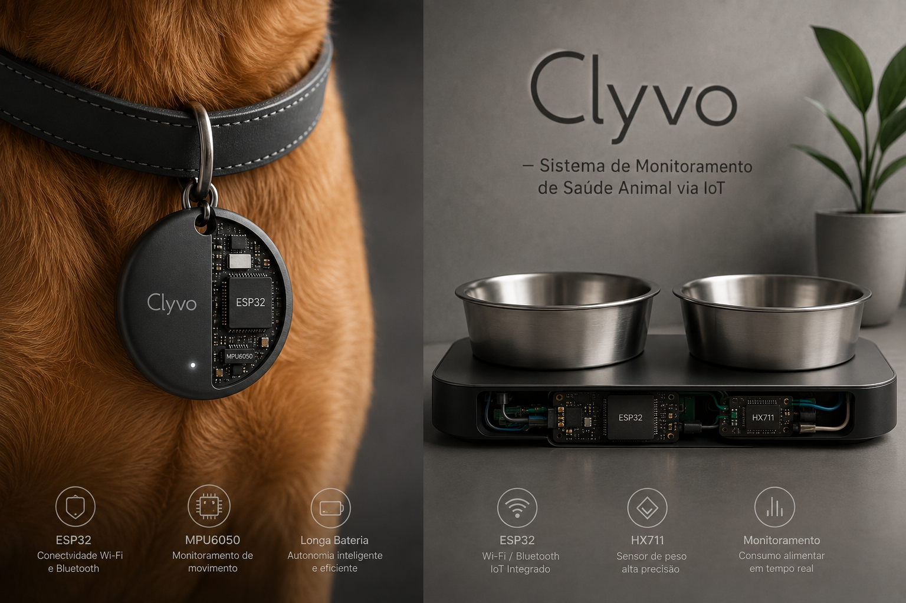
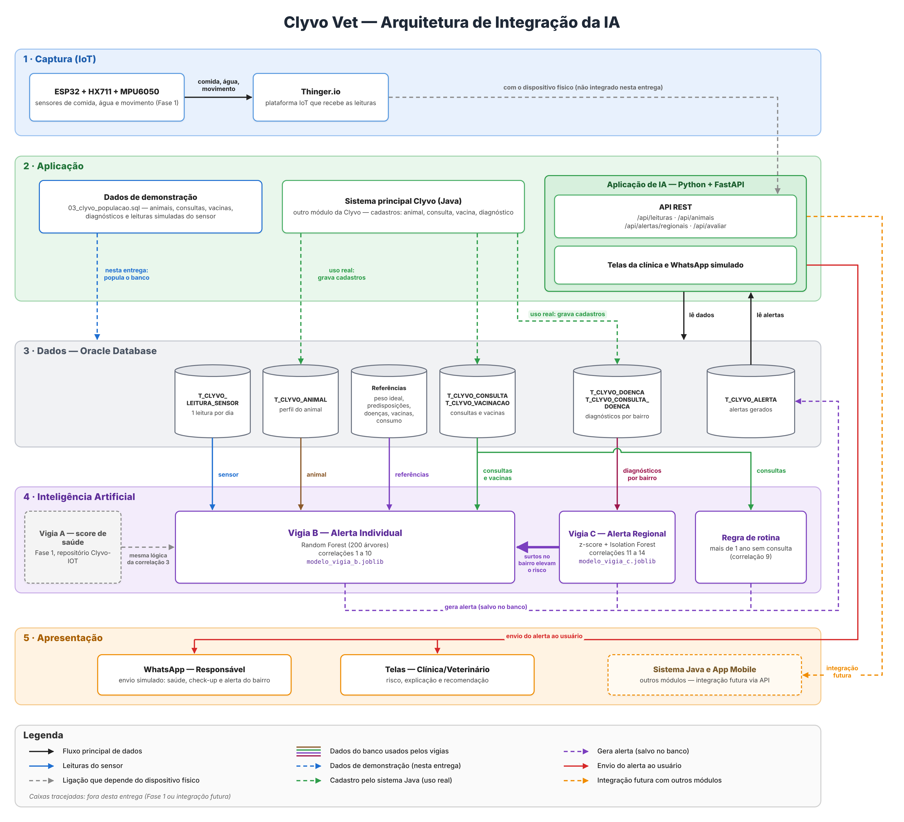
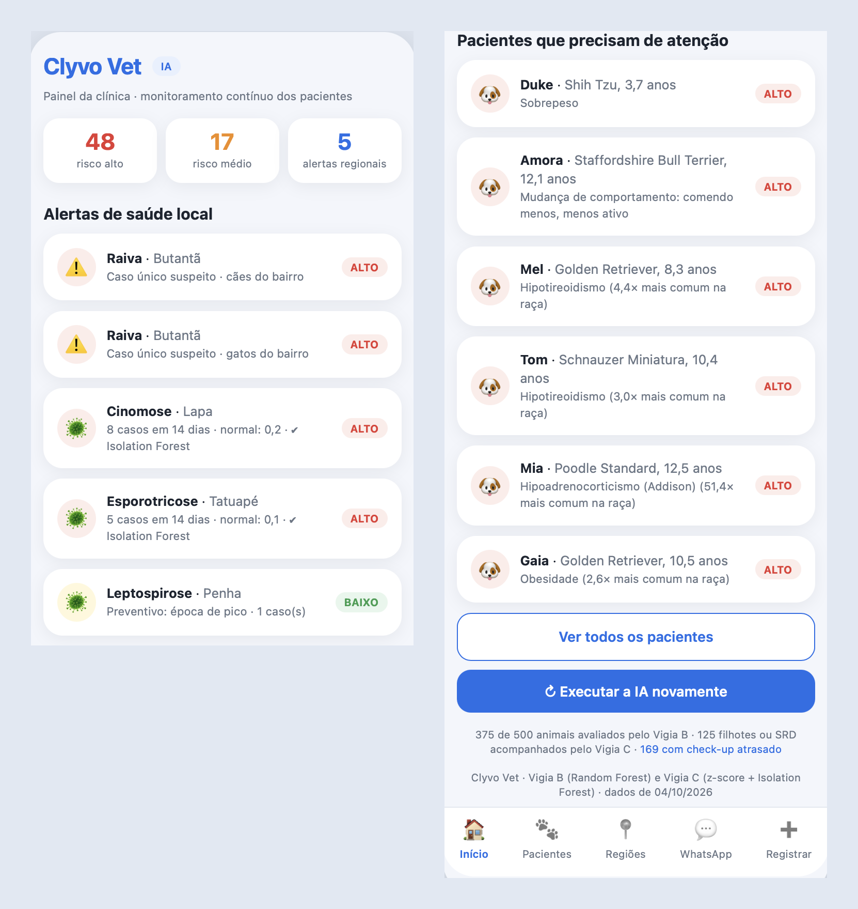
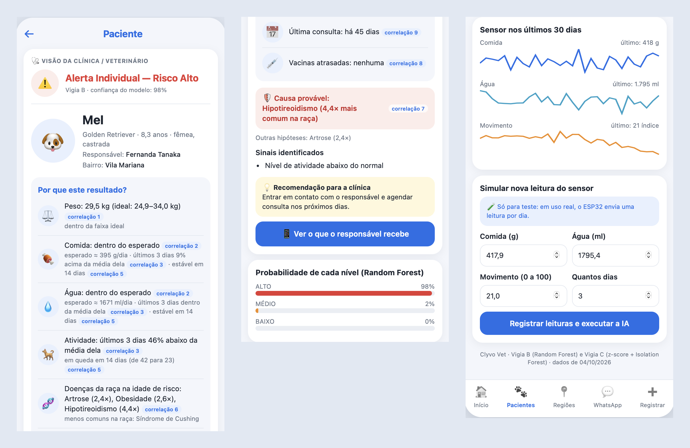
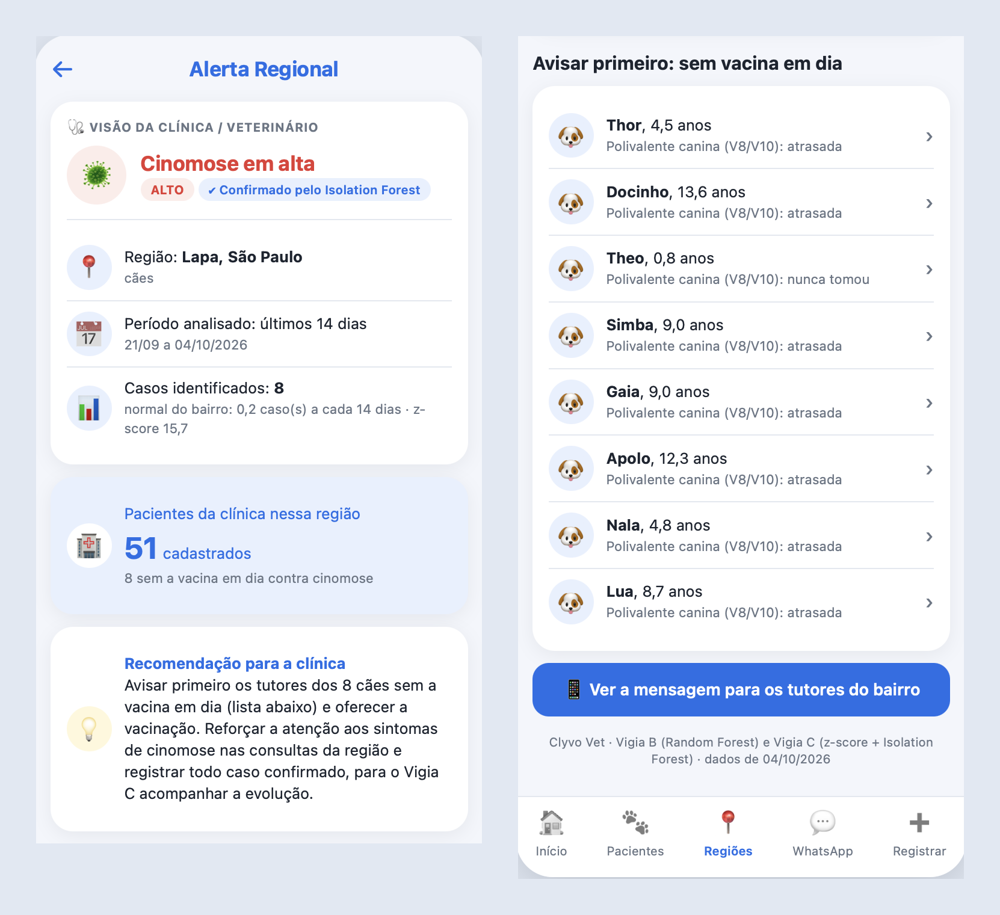
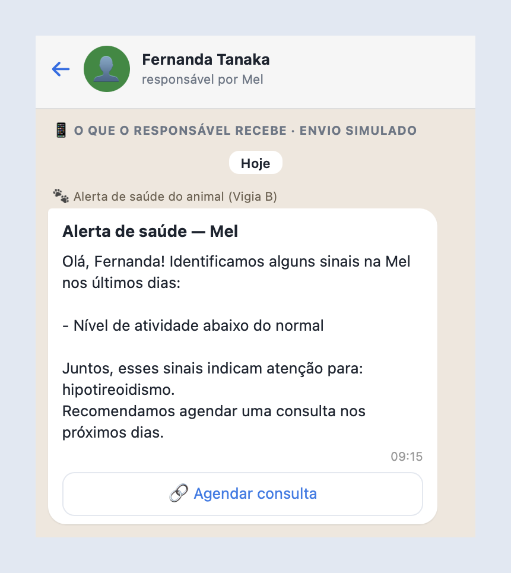
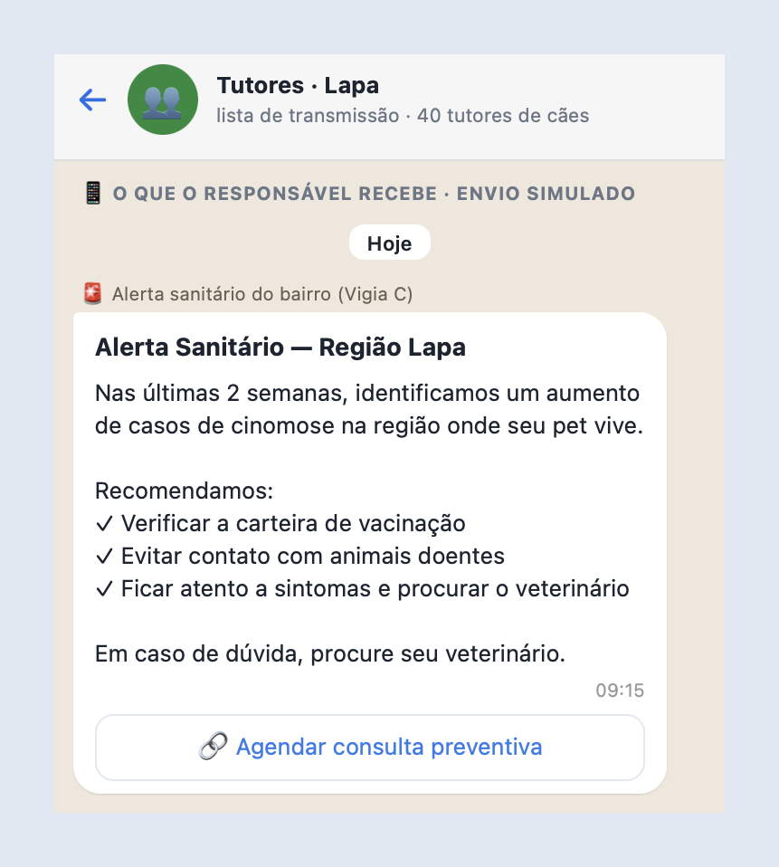
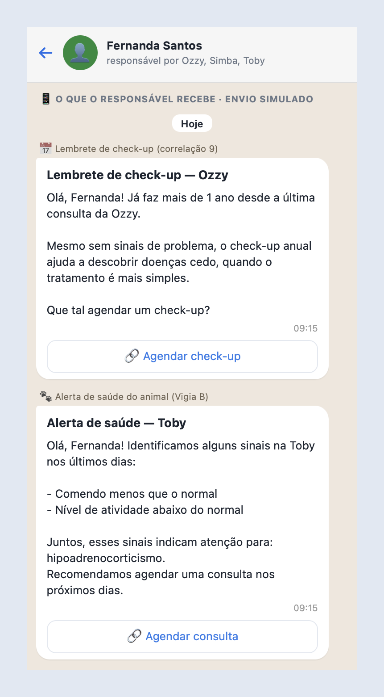

# Clyvo Vet — Componente de Inteligência Artificial

> Sistema de gestão veterinária centralizada para acompanhamento contínuo da
> saúde de animais, utilizando IoT, IoB & Generative IA



*Ilustração conceitual dos dispositivos IoT da Clyvo: coleira com ESP32 + MPU6050 (movimento) e comedouro com ESP32 + HX711 (comida e água).*

## Pitch do Projeto

[](https://www.youtube.com/watch?v=mDt0J5Usft4)

---

## Sumário

1. [Visão geral](#1-visão-geral)
2. [Problema de negócio](#2-problema-de-negócio)
3. [Abordagem de IA escolhida e justificativa técnica](#3-abordagem-de-ia-escolhida-e-justificativa-técnica)
4. [Estratégia de personalização, priorização, recomendação de serviços e apoio à decisão](#4-estratégia-de-personalização-priorização-recomendação-de-serviços-e-apoio-à-decisão)
5. [Dados necessários: origem, estrutura e utilização](#5-dados-necessários-origem-estrutura-e-utilização)
6. [As 14 correlações de dados](#6-as-14-correlações-de-dados)
7. [Fluxo de dados entre usuários, aplicação, banco de dados e IA](#7-fluxo-de-dados-entre-usuários-aplicação-banco-de-dados-e-ia)
8. [Diagrama Arquitetural](#8-diagrama-arquitetural)
9. [Tecnologias utilizadas](#9-tecnologias-utilizadas)
10. [Status de implementação e resultados parciais](#10-status-de-implementação-e-resultados-parciais)
11. [Instruções de uso](#11-instruções-de-uso)
12. [Fontes dos dados de referência](#12-fontes-dos-dados-de-referência)
13. [Equipe](#13-equipe)

---

## 1. Visão geral

Os animais não conseguem dizer o que estão sentindo, e por isso muitas vezes só são levados ao veterinário quando já estão mal. Sem check-ups regulares e sem um histórico de saúde organizado, o diagnóstico chega tarde. O objetivo da Clyvo é acompanhar a saúde do animal de forma **contínua**.

A **Clyvo Vet** é uma plataforma para clínicas e veterinários que reúne num só lugar o cadastro dos pacientes (idade, peso, espécie, raça, vacinas, consultas, responsável e endereço), as consultas e videoconsultas e a emissão de notas. O responsável recebe lembretes pelo WhatsApp para voltar à clínica.

Este repositório é o **módulo de Inteligência Artificial** da Clyvo. Ele junta três tipos de dados (o **comportamento** do animal, captado por sensores IoT de comida, água e movimento; o **cadastro**; e o **histórico clínico**) para gerar alertas em dois níveis:
- **individual:** um animal com sinais de risco para a saúde;
- **regional:** uma doença com mais casos do que o normal num bairro, ou na época do ano em que costuma aumentar (como a leptospirose nas chuvas).

Para isso, a Clyvo tem **três "vigias"**, cada um olhando para uma coisa:

| Vigia | O que observa | Como funciona | Nesta entrega |
|---|---|---|---|
| **A** (Fase 1, IoT) | o animal comparado com ele mesmo | compara a leitura de hoje com a média do próprio animal e calcula um score de saúde de 0 a 100 | já existia; as leituras do sensor foram simuladas no banco |
| **B** (Machine Learning) | o animal comparado com o esperado para o perfil dele | Random Forest que classifica o risco em BAIXO, MÉDIO ou ALTO | implementado |
| **C** (Machine Learning) | o bairro | z-score e Isolation Forest que detectam surtos de doenças | implementado |

### Vigia A — Já existe, Fase 1 — IoT, sem Machine Learning

Compara comida, água e movimento de hoje com a **média do próprio animal** e tira pontos a cada sinal anormal: acima de 85 é **Normal**, de 66 a 85 **Atenção**, de 36 a 65 **Preocupante** e até 35 **Crítico**. Exemplo: um cão que sempre bebe 300 ml de água e hoje bebeu 150 ml perde pontos, porque é pouco **para ele**. Mas o Vigia A não sabe se 150 ml é pouco para um cão daquela raça e daquele peso: é isso que o Vigia B resolve.

O Vigia A foi desenvolvido na Fase 1 do projeto, no repositório [Clyvo-IOT](https://github.com/Eduardo-Locaspi/Clyvo-IOT).

### Vigia B — Implementação de Machine Learning, gerando alerta individual

Sabe o que é esperado **para um animal daquele perfil** (espécie, raça, sexo, idade, peso) e cruza isso com o que o sensor mediu, olhando o quadro todo em vez de um sinal isolado. Exemplo: o Rex, um Labrador acima do peso que come 42% mais do que o esperado, numa raça com tendência à obesidade, recebe **risco ALTO** de obesidade (seção 10.1).

### Vigia C — Implementação de Machine Learning, alerta regional

Olha o **bairro**, juntando os diagnósticos de todas as clínicas parceiras numa base própria da Clyvo. Exemplo: cada clínica da Lapa viu só "alguns casos" de cinomose, mas juntos são 8 casos em duas semanas onde o normal é 0,2, e o Vigia C gera um **alerta regional** (seção 10.2).

### Como os três se conectam

Um surto no bairro (Vigia C) **aumenta o risco individual** (Vigia B) de um animal com sinais leves, que sozinhos não dariam alerta alto, como o Thor, cão da Lapa com a vacina atrasada que começou a comer menos. Os filhotes e os animais sem raça definida (SRD), que o Vigia B não avalia, aparecem na lista de animais sem vacina do alerta regional (seção 6.1).

---

## 2. Problema de negócio

### 2.1 O problema central

Os responsáveis muitas vezes só percebem que o animal está doente quando o quadro já está avançado, porque:
- **as mudanças são lentas:** uma queda de apetite de 5% ao dia não se nota, mas em duas semanas chega a 30–40%;
- **falta referência:** o responsável não sabe o que é "normal" para a espécie, a raça, a idade e o peso do seu animal;
- **faltam consultas de rotina:** sem sintomas visíveis, o check-up preventivo vai sendo adiado.

Há também um problema coletivo: **não existe uma forma rápida de saber quando uma doença está se espalhando num bairro**. Cada clínica vê só os próprios pacientes, e os boletins de prefeituras e governo costumam demorar. A ideia é que esses boletins sirvam para confirmar o alerta que a Clyvo já deu, e não como a única fonte.

### 2.2 O que já existe, e o que essa fase completa

| Etapa | O que faz |
|---|---|
| **Registro** (Fase 1) | Cadastro completo do animal: perfil, histórico clínico, vacinas, consultas e medicamentos |
| **Monitoramento** (Fase 1) | Sensores (ESP32 + HX711 + MPU6050) medindo comida, água e movimento, com o primeiro alerta estatístico (Vigia A) |
| **Entendimento** (Sprint 4) | Vigias B e C com Machine Learning, gerando alertas individuais, de rotina e regionais, explicados e gravados no banco |

Até aqui o sistema registrava e media; com a IA, ele passa a **entender** o que os dados significam, cruzando várias fontes para gerar alertas mais confiáveis, personalizados e preventivos.

### 2.3 Valor gerado para cada parte envolvida

| Para quem | Valor gerado |
|---|---|
| **Responsável** | Recebe alertas antecipados e em linguagem simples, sem precisar interpretar dados técnicos, como "risco de obesidade identificado, considere agendar uma consulta" |
| **Clínica/Veterinário** | Sabe quais pacientes precisam de atenção antes de chegarem graves e recebe alertas de surtos na região, podendo agir antes, e não só reagir |
| **Animal** | Tem problemas identificados mais cedo, quando o tratamento costuma ser mais simples, menos invasivo e mais barato, com um cuidado adequado ao seu perfil |

---

## 3. Abordagem de IA escolhida e justificativa técnica

### 3.1 Por que Machine Learning, e não as outras abordagens

O enunciado da Sprint 3 dá seis opções de abordagem de IA: IA Generativa, LLM, sistema de recomendação, motor de regras inteligentes, NLP ou modelo preditivo. As outras cinco não se encaixam bem no problema da Clyvo, que é decidir se a situação de um animal ou de um bairro é "normal" ou "risco" a partir de números e categorias (IA Generativa e LLM aparecem juntas na tabela porque o motivo é o mesmo):

| Abordagem | Por que não foi essa |
|---|---|
| **IA Generativa / LLM** | Serve para gerar conteúdo novo (texto, imagem, resumo), e a Clyvo não precisa gerar nada. Deixaria o sistema mais pesado e caro sem melhorar a resposta, e poderia dar respostas diferentes para o mesmo animal. |
| **NLP** | Serve para entender texto escrito por pessoas, mas os dados dos alertas são números e categorias (peso, raça, datas). O único texto livre, a anotação da consulta, não é usado nos alertas. |
| **Sistema de recomendação** | Serve para sugerir algo parecido com o que a pessoa já gostou ("quem viu isso também gostou daquilo"). A Clyvo não sugere produtos: avalia risco de saúde a partir de sinais concretos. |
| **Motor de regras inteligentes** | Foi a opção mais próxima. Mas alguém teria que escrever cada condição na mão ("se o peso passar de X, gera alerta"), o que fica difícil de manter com tantas informações para cruzar (peso, raça, idade, tendência, histórico). O modelo preditivo aprende essas combinações sozinho a partir de exemplos. As regras continuam onde fazem mais sentido: na causa provável (seção 3.3) e nos alertas imediatos do Vigia C, como a raiva. |

### 3.2 Abordagem escolhida: Modelo Preditivo (Machine Learning)

Das opções do enunciado, o projeto usa **modelo preditivo** 
(o Vigia B é um **sistema de classificação**): os dados do animal e do bairro são usados para **antecipar** um problema antes que ele fique grave, seja o risco de saúde de um animal, seja o começo de um surto numa região.

Essa abordagem é dividida em duas partes, o Vigia B e o Vigia C. Elas respondem perguntas diferentes e, por isso, aprendem de formas diferentes: o Vigia B aprende com exemplos que já têm a resposta certa (**supervisionado**), e o Vigia C aprende o que é normal em cada bairro, sem resposta pronta (**não supervisionado**). Os dois vigias usam algoritmos baseados em **árvores de decisão**: o Random Forest e o Isolation Forest são formados por várias árvores. Essa família foi escolhida pelas características dos dados (seção 3.3).

| | Vigia B — alerta individual | Vigia C — alerta regional |
|---|---|---|
| **Pergunta que responde** | "Qual o nível de risco **deste animal**?" | "Este bairro está com **mais casos do que o normal**?" |
| **Os exemplos têm a resposta certa?** | Sim: cada animal do treino tem o nível de risco | Não: não existe uma base de "isso foi surto / isso não foi" |
| **Tipo de aprendizado** | **Supervisionado** (classificação em BAIXO, MÉDIO ou ALTO) | **Não supervisionado** (detecção de anomalia) |
| **Machine Learning** | **Random Forest** (200 árvores de decisão que votam), escolhido depois de comparado no notebook com uma **Árvore de Decisão** única: acertou 89,1% contra 86,5%. Só o Random Forest é usado na aplicação; a árvore única serve no notebook para desenhar como a decisão é tomada | **Isolation Forest**, que confirma se a situação do bairro é uma anomalia |
| **Apoio estatístico ou de regras** | Regra da causa provável (correlação 7) | **z-score**, que decide o alerta, e as regras de raiva e época de pico |

### 3.3 Vigia B — Alerta Individual Preditivo

**O que faz:** classifica o nível de risco de saúde de um animal específico (BAIXO, MÉDIO ou ALTO), cruzando o perfil do animal (espécie, raça, idade, peso), os dados dos sensores (comida, água, movimento) e o histórico clínico (vacinação, frequência de consultas).

#### Por que aprendizado supervisionado, do tipo classificação

No aprendizado supervisionado, o modelo aprende com exemplos que **já têm a resposta certa** (o "gabarito"). No Vigia B, cada exemplo é um animal com as 10 correlações calculadas (seção 6) e o nível de risco correspondente. O modelo compara as informações com a resposta, milhares de vezes, até aprender sozinho quais combinações levam a cada nível. Como o resultado que a Clyvo quer (o nível de risco) é conhecido nos exemplos, o supervisionado é o caminho natural.

É um problema de **classificação** porque a resposta é uma categoria (**BAIXO, MÉDIO ou ALTO**), e não um número contínuo, como seria numa regressão (por exemplo, prever o peso daqui a um mês). A categoria é o que a clínica e o responsável precisam para decidir o que fazer. Além disso, o classificador devolve a probabilidade de cada nível, que aparece no alerta como a **confiança** do modelo.

#### De onde vem a resposta certa (o gabarito)

Não existe uma base pública que junte leituras de sensores de comida, água e movimento com o diagnóstico do veterinário. Por isso, o dataset de treino é simulado: 8.000 animais fictícios adultos das 24 raças, cada um com 30 dias de leituras, seguindo as referências reais da seção 12. O nível de risco de cada animal (o gabarito) vem de uma **pontuação baseada nessas referências**. O modelo **não recebe essa pontuação**: recebe só as informações do animal e a resposta, e aprende sozinho a reproduzi-la.

**Como a pontuação funciona:** cada sinal de alerta soma pontos (os mais fortes valem mais), e o total define o nível.

| Grupo | Situação | Pontos |
|---|---|---|
| **Peso** (correlações 1, 4 e 10) | mais de 15% acima do peso ideal da raça | +3 |
| | entre 5% e 15% acima do peso ideal | +2 |
| | mais de 10% abaixo do peso ideal | +2 |
| | acima do peso **e** comendo mais de 10% acima do esperado (ou abaixo do peso **e** comendo mais de 10% abaixo) | +2 |
| | castrado e acima de 90% do peso máximo da raça | +1 |
| **Consumo × esperado** (correlação 2) | bebendo mais de 30% acima do esperado | +1,5 |
| | comendo mais de 30% abaixo do esperado | +1,5 |
| **Últimos 3 dias × o normal do animal** (correlação 3) | comendo mais de 30% menos | +3 |
| | comendo entre 15% e 30% menos | +1 |
| | comendo mais de 30% a mais | +1,5 |
| | bebendo mais de 30% a mais, ou mais de 30% a menos | +2 |
| | se movimentando mais de 30% menos | +2 |
| **Tendência em 14 dias** (correlação 5) | comida caindo mais de 25% | +2 |
| | água subindo mais de 25% | +2 |
| | movimento caindo mais de 25% | +2 |
| **Doenças da raça** (correlações 6 e 7) | raça predisposta, na idade de risco, com o sinal da doença no sensor, sendo a predisposição forte (razão de risco ≥ 2 ou mutação genética) | +3 |
| | o mesmo, com predisposição não forte | +2 |
| | se a doença for de sinal tardio (doença valvar, cardiomiopatia) | metade dos pontos acima |
| | só está na idade de risco, sem o sinal | +0,5 |
| **Vacinas, bairro e consultas** (correlações 8 e 9, Vigia C) | vacina atrasada que previne a doença em surto no bairro | +2,5 |
| | outra vacina atrasada | +0,5 |
| | bairro com surto **e** o animal já com sinais (2 pontos ou mais, ou comida ou movimento abaixo de 90% do normal dele) | +1,5 |
| | mais de 1 ano sem consulta | +1 se já tem 2 pontos ou mais; senão +0,5 |

| Total de pontos | Nível de risco |
|---|---|
| 6 ou mais | **ALTO** |
| de 3 a menos de 6 | **MÉDIO** |
| menos de 3 | **BAIXO** |

**Exemplo:** um Labrador castrado de 6 anos, com 40 kg (faixa ideal até 36,3 kg) e comendo 42% acima do esperado, soma: 10% acima do peso (+2), acima do peso e comendo mais (+2), castrado perto do limite (+1) e raça predisposta à obesidade com o sinal no sensor (+2) = **7 pontos → ALTO**.

Os pesos de cada sinal e os limites de 3 e 6 pontos são critérios da equipe: os sinais mais fortes (queda grande de apetite, predisposição forte da raça, vacina atrasada para um surto) valem mais, e um único sinal isolado não chega a risco alto. Para que o modelo aprenda o padrão e não apenas decore a pontuação, as leituras têm ruído e variação individual, as alterações têm intensidades diferentes (casos leves e de fronteira) e **6% das respostas foram trocadas para o nível vizinho**, simulando a discordância natural entre avaliações.

Com a Clyvo em uso, o gabarito passaria a ser o **diagnóstico do veterinário** após a consulta, e o modelo seria treinado de novo com esses casos reais. Aí ele poderia aprender padrões que as referências não descrevem.

#### Por que Random Forest

O Random Forest é formado por várias **árvores de decisão**. Cada árvore faz perguntas em sequência sobre o animal ("a raça é Labrador?", "a comida está mais de 30% acima do esperado?") até chegar a um nível de risco. O Random Forest treina **200 árvores**, cada uma com uma amostra diferente dos animais e olhando só parte das colunas em cada pergunta. No final, **as árvores votam** e vence o nível mais votado. A escolha partiu das características dos dados e do problema da Clyvo:

| Característica do problema | Por que o Random Forest atende |
|---|---|
| **Mistura de números e categorias** (peso, gramas, dias, raça, espécie) | As perguntas das árvores trabalham com os dois tipos ao mesmo tempo. |
| **Escalas muito diferentes** (gramas de comida, ml de água, dias sem consulta, proporções) | Cada pergunta olha uma coluna por vez, então não é preciso normalizar os dados, o que muitos algoritmos exigem. |
| **O risco depende de combinações** ("raça predisposta **e** sinal alterado **e** na idade de risco") | Cada caminho de uma árvore é exatamente uma combinação de condições, enquanto modelos que somam cada informação separadamente não captam bem essas combinações. |
| **Dados com ruído e 6% de respostas trocadas** | O erro de uma árvore é compensado pelas outras na votação. |
| **Área da saúde, que precisa explicar a decisão** | Não é uma "caixa-preta": mostra quais correlações mais pesaram (importância de cada uma), e a confiança é fácil de explicar, porque é a proporção de árvores que apontou aquele nível (180 de 200 em "ALTO" = 90%). |
| **Quantidade média de dados** (8.000 animais) | Funciona bem com esse volume, sem precisar das grandes bases que as redes neurais exigem, e treina em poucos segundos. |

**Comparação com uma árvore só:** uma única Árvore de Decisão é mais fácil de desenhar, mas é **instável** (pequenas mudanças nos dados mudam bastante as perguntas que ela faz) e tende a "decorar" o treino (overfitting). No notebook, as duas foram treinadas e comparadas: o Random Forest acertou **89,1%** contra **86,5%** da árvore única, e por isso é o modelo usado na aplicação. A árvore única (8 níveis) continua no notebook para **mostrar visualmente** como a decisão é tomada, já que 200 árvores juntas não cabem num desenho. Os parâmetros dos dois modelos foram escolhidos com **GridSearchCV** e **validação cruzada**, e o resultado foi medido em animais que o modelo nunca viu (seção 10.1).

#### O que o modelo responde, e o que vem de regra

O modelo dá o **nível de risco** e a confiança. A **causa mais provável** que aparece no alerta vem de uma regra da correlação 7: entre as doenças a que a raça é predisposta, na idade de risco, cujo sinal combina com o que o sensor mediu, vence a de mais sinais combinando e depois a de maior razão de risco. Sem nenhuma, o alerta mostra a doença em surto no bairro (se a vacina estiver atrasada), o peso fora da faixa ou o próprio sinal ("comendo menos", "menos ativo"). O sensor vê sintomas, não doenças: a causa é uma hipótese para o veterinário confirmar.

### 3.4 Vigia C — Alerta Regional Epidemiológico

**O que faz:** identifica concentrações fora do padrão de casos de determinada doença numa mesma região (bairro), ao longo do tempo, gerando um alerta que não é sobre um animal específico, mas sobre uma área geográfica.

#### Por que não supervisionado

Para usar classificação, como no Vigia B, seria preciso uma base com milhares de situações marcadas como "isso foi surto" ou "isso não foi surto". Essa base não existe, e surtos são **raros por natureza**: mesmo com dados reais, haveria pouquíssimos exemplos para aprender. Por isso o Vigia C usa **detecção de anomalia**, que é não supervisionada: aprende como é o **normal** de cada bairro e aponta o que **foge muito** desse normal. É a mesma lógica dos sistemas de vigilância epidemiológica, que acompanham desvios no volume de casos por região e período.

#### z-score: o método que decide o alerta

Os casos de cada doença são contados por bairro em janelas de **14 dias**, e o **z-score** compara o número atual com o histórico daquele mesmo bairro:

> z = (casos agora − média histórica) ÷ variação histórica

Exemplo: a Lapa teve 8 casos de cinomose em 14 dias, quando a média histórica era de 0,2 caso. O z deu 15,7, muito acima do normal.

Por que o z-score decide:
- **É fácil de explicar** para a clínica e para o responsável ("8 casos onde o normal é 0,2").
- **Respeita o normal de cada bairro:** um bairro que sempre tem casos não dispara alerta à toa, e um bairro que nunca tem casos dispara com poucos.
- **Permite limites diferentes por tipo de doença** (correlação 14): doença contagiosa dispara com z ≥ 2 e 2 casos; a erliquiose, que não passa de um animal para outro, precisa de z ≥ 3 e 4 casos.
- **Funciona com pouco histórico** e sempre dá a mesma resposta para os mesmos dados.

#### Isolation Forest: a confirmação independente

O **Isolation Forest** é um algoritmo de Machine Learning **não supervisionado**, também formado por árvores. A ideia é simples: **o que é raro é fácil de isolar**. Ele faz cortes aleatórios nos dados (por exemplo, "casos > 3?", "média histórica < 0,5?"): uma situação comum precisa de muitos cortes até ficar sozinha, e uma situação rara, como 8 casos onde o normal é 0,2, fica isolada em poucos. Repetindo isso em 200 árvores, cada situação recebe uma **nota de anomalia**. No Vigia C, cada situação é um bairro + doença + espécie + janela de 14 dias, descrita por: número de casos, média histórica, z-score, se a doença é contagiosa e se está na época de pico.

O modelo é treinado só com as **janelas do passado** (3.040 situações em 2 anos), salvo em `modelo_vigia_c.joblib` e usado pela aplicação para avaliar a **janela atual**. Foi a melhor escolha para o projeto porque:
- **Não precisa de gabarito**, que é justamente o que falta no Vigia C.
- **Foi criado para encontrar o que é raro:** aponta diretamente o que é anormal, em vez de só separar os dados em grupos parecidos.
- **O passado define o normal e o presente é julgado:** se a janela atual entrasse no treino, um surto em andamento passaria a fazer parte do que o modelo considera normal. É assim que funcionam os sistemas de monitoramento: o que está sendo investigado não ensina o modelo.
- **Funciona bem com poucos dados e poucas colunas**, sem precisar normalizar, e treina em menos de 1 segundo, então pode ser treinado de novo sempre que o histórico crescer.
- **Segue o mesmo fluxo do Vigia B:** treinar no notebook, salvar no joblib, carregar e usar na aplicação.

#### Por que o Isolation Forest confirma, e não decide

- **Ele precisa de um palpite de quanto do histórico é anomalia** (o parâmetro `contamination`, de 0,5%). Mudar esse valor muda quantas situações ele aponta, sem um critério epidemiológico para escolher.
- **A nota dele não é fácil de explicar** para a clínica, ao contrário de "8 casos onde o normal é 0,2".
- **Ele não conhece as regras das doenças:** não sabe que a raiva exige alerta com 1 caso, nem que a erliquiose precisa de mais casos por não ser contagiosa.

Por isso o z-score, com limites claros e justificáveis, **decide** o alerta, e o Isolation Forest funciona como uma **segunda opinião independente**. Nos testes, sem nenhuma regra definida pela equipe, ele apontou como anomalia exatamente os dois surtos da janela atual (cinomose na Lapa e esporotricose no Tatuapé), e não o caso preventivo de leptospirose na Penha. Quando os dois concordam, o alerta mostra "Confirmado pelo Isolation Forest".

As situações em que **a estatística não deve esperar** ficam em regras próprias, baseadas nas referências da seção 12: a **raiva** gera alerta imediato com 1 caso suspeito (é fatal e transmissível a humanos), e a **leptospirose** gera alerta preventivo com 1 caso na época de pico (outubro a março).

---

## 4. Estratégia de personalização, priorização, recomendação de serviços e apoio à decisão

| Estratégia | Como a IA faz | Onde aparece na aplicação |
|---|---|---|
| **Personalização** | Não usa limites fixos e iguais para todos: compara cada animal com o esperado para o perfil dele (espécie, raça, sexo, idade, peso, castração) e com a própria média. O mesmo consumo de água pode ser normal para uma raça e alterado para outra. No Vigia C, cada bairro também é comparado com o seu próprio histórico. | Faixa de peso da raça, consumo esperado, predisposições e proteções da raça na idade de risco, castração como fator de risco e comparação com a média do próprio animal. |
| **Priorização** | Os três níveis (BAIXO, MÉDIO, ALTO) e a confiança do modelo mostram quais casos precisam de atenção primeiro, em vez de tratar todos com a mesma urgência. | Lista de pacientes ordenada pelo nível e pela confiança; filtros por nível e por check-up atrasado; no alerta regional, a lista "Avisar primeiro" com os animais sem a vacina em dia. |
| **Recomendação de serviços** | Cada alerta traz o próximo passo: consulta, check-up de rotina ou vacinação. | Recomendação para a clínica em cada alerta (ex.: "entrar em contato com o responsável e agendar consulta nos próximos dias"); mensagem de WhatsApp do tutor em linguagem simples, com o botão de agendar (visual nesta entrega, pois o envio é simulado). |
| **Apoio à decisão** | O sistema faz uma **triagem**, não um diagnóstico: sinaliza quando vale buscar avaliação e explica o porquê. A decisão continua com o veterinário. | Quadro "Por que este resultado?", com cada dado ligado à correlação que o gerou, a causa provável com as outras hipóteses, as probabilidades e os gráficos do sensor. |

---

## 5. Dados necessários: origem, estrutura e utilização

### 5.1 Visão geral

| Categoria | Onde está no banco de dados | Como é utilizada |
|---|---|---|
| **Perfil do animal** | `T_CLYVO_ANIMAL` | Espécie, raça, sexo, data de nascimento (idade calculada), peso, castração e energia da ração. Base de todas as comparações personalizadas do Vigia B |
| **Histórico clínico** | `T_CLYVO_CONSULTA_DOENCA`, `T_CLYVO_DOENCA` | Doenças diagnosticadas em cada consulta, ligadas ao bairro do animal: são os casos que o Vigia C conta por região |
| **Consultas** | `T_CLYVO_CONSULTA` | Data da consulta mais recente: dias sem consulta (correlação 9) e alerta de check-up de rotina. O texto da consulta (`historico_consulta`) fica registrado, mas não é usado pela IA (seção 3.1, NLP) |
| **Vacinas** | `T_CLYVO_VACINACAO` | Situação de cada vacina (efetuada, pendente, atrasada): vacinas atrasadas e vacina atrasada contra a doença em surto no bairro (correlação 8), e a lista de animais sem vacina em dia do alerta regional |
| **Medicamentos** | `T_CLYVO_MEDICAMENTO`, `T_CLYVO_PRESCRICAO` | Cadastrados, mas não usados pela IA nesta entrega. Possível aprimoramento: evitar falso alerta quando o sinal do sensor é efeito esperado do remédio (seção 10.4) |
| **Comportamento** | `T_CLYVO_LEITURA_SENSOR` | Uma leitura por dia do ESP32 (simulada nesta entrega): comida, água e movimento, usados nas correlações 2, 3, 5 e 7 |
| **Demais informações relevantes** | Tabelas de referência (seção 12) e `T_CLYVO_ENDERECO_ANIMAL` | Peso ideal, predisposições e proteções por raça, idade de risco e sinais de cada doença, catálogo de doenças, vacinas × doenças, fórmulas de consumo e energia das rações; o bairro do animal, usado no alerta regional |
| **Resultado da IA** | `T_CLYVO_ALERTA` | Alertas gerados pelos vigias: tipo (individual, rotina ou regional), nível, confiança do modelo, motivo, recomendação e situação do envio ao tutor |

### 5.2 Origem, estrutura e utilização

- **Dados cadastrais** (perfil, endereço, vacinas, consultas, medicamentos): inseridos pela clínica no sistema principal da Clyvo (o responsável interage apenas pelo WhatsApp). Ficam num banco relacional em Oracle. A espécie vem de uma tabela própria (`T_CLYVO_ESPECIE`), para que uma espécie nova no futuro (por exemplo, equinos) seja só um cadastro novo.
- **Dados de sensor:** captados pelo ESP32 com os sensores HX711 (peso da comida e da água) e MPU6050 (movimento, na coleira) e gravados em `T_CLYVO_LEITURA_SENSOR`, uma leitura por dia: o sensor capta vários valores ao longo do dia e, no fim, junta tudo numa leitura diária (total de comida, total de água e movimento médio), que é a que a IA usa. Nesta entrega, as leituras foram simuladas no banco nesse mesmo formato (seção 8.1).
- **Dados de referência:** as 7 planilhas da pasta `referencias/` (peso ideal, predisposições, doenças, catálogo de doenças, vacinas, fórmulas de consumo e rações), carregadas no banco. Vêm de fontes públicas e estudos científicos (seção 12) e são a "régua de comparação" dos vigias: o que é esperado para cada perfil de animal e como cada doença se comporta.
- **Datasets dos modelos**, entregues prontos em CSV:
  - `ia/vigia_b/dataset_vigia_b.csv`: 8.000 animais fictícios, simulados a partir das referências da seção 12. Um modelo de Machine Learning precisa de muitos exemplos para encontrar um padrão confiável, bem mais do que os 375 animais do banco; por isso o treino usa esse dataset, e os animais do banco servem de teste com dados que o modelo nunca viu (seção 10.1).
  - `ia/vigia_c/casos_vigia_c.csv`: os diagnósticos de doenças infecciosas exportados do banco (2 anos, 10 bairros), usados para treinar o Isolation Forest e para o notebook rodar sem o Oracle.

### 5.3 Dados da demonstração

O banco é montado por três scripts SQL, já prontos, nesta ordem:

| Script | O que faz | Origem dos dados |
|---|---|---|
| `01_clyvo_ddl_oracle.sql` | cria as 23 tabelas (cadastro + IA + referências) | — |
| `02_clyvo_referencias.sql` | carrega as tabelas de referência (136 linhas: 2 espécies, 21 doenças, 30 faixas de peso, 57 predisposições e proteções, 4 vacinas ligadas a 11 doenças, 4 fórmulas de consumo e 7 rações) | planilhas da seção 12 (`referencias/`), sem alterar nenhum valor |
| `03_clyvo_populacao.sql` | carrega os pacientes da demonstração | dados simulados |

**Pacientes (dados simulados):** como não há dados reais de pacientes, eles foram simulados seguindo as referências da seção 12: peso em torno da faixa da raça, consumo pelas fórmulas veterinárias, vacinas com reforço anual e algumas doenças crônicas "escondidas" nas leituras do sensor, que são os casos que a IA deve encontrar. A data de referência da demonstração é **04/10/2026**, dentro da época de pico da leptospirose (outubro a março).

---

## 6. As 14 correlações de dados

Uma **correlação** é um cruzamento de dados que ajuda a IA a decidir. As 10 primeiras são do Vigia B e as 4 últimas, do Vigia C. O código está em `ia/vigia_b/clyvo_features.py` e `ia/vigia_c/clyvo_regional.py`, usados tanto pelos notebooks quanto pela aplicação.

O Vigia B recebe, para cada animal, uma **ficha** com o perfil (espécie, raça, idade, peso, castração) e as colunas calculadas pelas correlações abaixo, mais a coluna `alerta_regional`, que diz se há surto no bairro. Como o modelo só trabalha com números, a espécie e a raça viram colunas de 0 e 1, e a ficha fica com **48 colunas**.

### Vigia B — 10 correlações (alerta individual)

| # | Correlação (coluna no modelo) | Como funciona |
|---|---|---|
| 1 | **Peso × faixa ideal da raça** (`desvio_peso`) | Compara o peso com a faixa saudável da espécie, da raça e do sexo (seção 12): 0 dentro da faixa, positivo acima e negativo abaixo |
| 2 | **Consumo × consumo esperado** (`comida_vs_esperado`, `agua_vs_esperado`) | Média dos últimos 7 dias ÷ o consumo esperado, calculado pelas fórmulas do Manual Veterinário MSD a partir do peso, da castração e da energia da ração (`ref_consumo.csv`). Só conta como alterado o que sai da margem de 30% |
| 3 | **Consumo × média do próprio animal** (`comida_vs_baseline`, `agua_vs_baseline`, `mov_vs_baseline`) | Média dos últimos 3 dias ÷ média das semanas anteriores do mesmo animal (a lógica do Vigia A). Usar 3 dias diminui o efeito de um dia atípico. Ex.: um cão que bebia 300 ml passa a beber 150 ml: 0,5 |
| 4 | **Peso × consumo** (`peso_x_comida`) | +1 se está acima do peso **e** comendo acima do esperado (reforça obesidade), −1 se está abaixo do peso **e** comendo abaixo (reforça desnutrição) |
| 5 | **Tendência em 14 dias** (`tend_comida`, `tend_agua`, `tend_mov`) | Mede se a leitura está subindo ou caindo aos poucos, por regressão linear, e percebe mudanças em que nenhum dia isolado parece estranho. Ex.: o movimento da Mel caiu de cerca de 42 para 23 em duas semanas |
| 6 | **Raça × idade × doença** (`idade_risco`) | Vale 1 se o animal já chegou à idade em que uma doença a que a raça é predisposta fica comum (seção 12) |
| 7 | **Doença da raça × sinal no sensor** (`predisp_sinal_alterado`, `predisp_forte`, `sinal_tardio`) | Vale 1 quando o animal está na idade de risco **e** o sensor mostra o sinal daquela doença. Também marca se a predisposição é forte e se o sinal só aparece com a doença avançada (pesa menos). Define a causa mais provável (seção 3.3). Ex.: a Mel se mexe menos: hipotireoidismo, com artrose como segunda hipótese |
| 8 | **Situação vacinal** (`vacinas_atrasadas`, `vacina_doenca_regional`) | Conta as vacinas atrasadas (mais de 12 meses) e marca 1 quando uma delas previne a doença em surto no bairro (seção 12) |
| 9 | **Tempo desde a última consulta** (`dias_sem_consulta`) | Entra no modelo e, acima de 365 dias, gera o alerta separado de **check-up de rotina** |
| 10 | **Castração × peso** (`castrado_perto_limite`) | A castração não muda o peso ideal, mas aumenta a tendência a engordar (seção 12). Vale 1 quando o animal é castrado e já passou de 90% do peso máximo da raça |

### Vigia C — 4 correlações (alerta regional)

| # | Correlação | Como funciona |
|---|---|---|
| 11 | **Casos por bairro em 14 dias** | Conta os diagnósticos por bairro, doença e espécie em janelas de 14 dias e compara com o histórico do bairro pelo z-score (seção 3.4). Entram todos os animais, inclusive filhotes e SRD |
| 12 | **Doença × época de pico** | Na época de pico, 1 caso já gera alerta preventivo (BAIXO). Só a leptospirose tem pico comprovado no Brasil: outubro a março (seção 12) |
| 13 | **Doença × espécie-alvo** | Só conta o caso se a espécie do animal for a da doença, para não misturar cães e gatos. A raiva está cadastrada para as duas espécies |
| 14 | **Contagiosidade** | Doença contagiosa dispara com menos casos (z ≥ 2 e 2 casos); a erliquiose, que não passa de um animal para outro, precisa de z ≥ 3 e 4 casos; a raiva gera alerta com 1 caso suspeito. Ex.: em Pinheiros, onde a parvovirose é rara, 2 casos já disparam alerta; 2 casos de erliquiose, não |

### 6.1 Conexão entre os vigias B e C

A aplicação roda primeiro o Vigia C. Os surtos ativos (MÉDIO ou ALTO) entram no Vigia B pelas colunas `alerta_regional` e `vacina_doenca_regional` de cada animal do bairro e da espécie afetada.

Como o Vigia B avalia só os adultos das 24 raças, o Vigia C também lista, em cada alerta regional, os **animais do bairro sem a vacina em dia**, de qualquer idade ou raça (inclusive filhotes e SRD, os mais expostos), para a clínica avisar primeiro.

---

## 7. Fluxo de dados entre usuários, aplicação, banco de dados e IA

1. A **clínica/veterinário** cadastra o animal e registra consultas, diagnósticos, vacinas e medicamentos no sistema principal da Clyvo. O **responsável** não usa aplicativo: ele interage apenas pelo WhatsApp.
2. O **ESP32** capta ao longo do dia a comida, a água e o movimento do animal e envia **uma leitura por dia**: total de comida (g), total de água (ml) e movimento médio (0 a 100). Nesta entrega, essas leituras foram simuladas no banco (seção 8.1).
3. Tudo fica no **banco de dados Oracle**: cadastro, histórico clínico, leituras do sensor e tabelas de referência.
4. A **aplicação de IA** lê o banco, roda primeiro o **Vigia C** (surtos por bairro) e depois o **Vigia B** (já considerando os surtos), aplica a regra do check-up de rotina e grava os resultados em `T_CLYVO_ALERTA`.
5. A **clínica** vê os alertas explicados nas telas da aplicação; o **responsável** recebe a mensagem pelo **WhatsApp** (simulado nesta entrega); e o sistema principal e o app mobile podem ler os mesmos resultados pela **API**.

---

## 8. Diagrama Arquitetural



O caminho dos dados está descrito na seção 7. A ligação entre o Thinger.io e a aplicação aparece tracejada porque depende do dispositivo físico (seção 8.1).

### 8.1 Por que o Thinger.io não foi integrado nesta entrega

O ESP32 da Fase 1 roda no simulador Wokwi, que só gera leituras enquanto a simulação está aberta no navegador. Assim, não dá para juntar dias seguidos de leituras de vários animais, e o Vigia B precisa disso: ele analisa os últimos 30 dias de cada animal. Ligar a aplicação ao Thinger.io traria só alguns minutos de dados de um único animal simulado.

Por isso, as leituras foram criadas como dados fictícios direto no banco Oracle (60 dias para cada um dos 375 animais acompanhados), no mesmo formato do ESP32. A ligação passa a funcionar com o dispositivo físico ligado continuamente: a API já tem o endereço `POST /api/leituras`, que recebe uma leitura nesse formato, grava no Oracle e devolve o risco atualizado.

---

## 9. Tecnologias utilizadas

| Camada | Tecnologia | Por que |
|---|---|---|
| IoT (Fase 1) | ESP32 no simulador Wokwi, sensores HX711 ×2 (peso da comida e da água) e MPU6050 (movimento); Thinger.io e Node.js | Medem e enviam os três sinais de comportamento usados pelos vigias; não integrados à aplicação de IA nesta entrega (seção 8.1) |
| Banco de dados | Oracle Database, acessado pelo Python com `python-oracledb` | Banco relacional que mantém ligados animal, responsável, endereço, consultas, vacinas e diagnósticos, que é exatamente o que as correlações cruzam. É o mesmo banco e modelo do sistema principal da Clyvo, então a IA lê os dados da clínica sem precisar de cópia |
| Dados e análise | Python com `pandas`, `numpy`, Jupyter Notebook e `matplotlib` | Preparar os dados, calcular as correlações e mostrar cada etapa do treino com gráficos e resultados |
| Machine Learning | `scikit-learn` (`RandomForestClassifier`, `DecisionTreeClassifier`, `IsolationForest`, `Pipeline`, `GridSearchCV`); `joblib` | Biblioteca padrão de ML em Python, com todos os algoritmos escolhidos (seção 3); o `joblib` salva o modelo treinado para a aplicação usar |
| Aplicação de IA | FastAPI e Uvicorn | Criam as telas e a API no mesmo Python dos modelos, que são carregados direto, sem conversão; a documentação da API é gerada sozinha em `/docs` |
| Telas | Jinja2, HTML e CSS próprios, gráficos em SVG | Seguem o visual do app mobile da Clyvo e são leves: abrem em qualquer navegador, sem instalar nada além do Python |
| Configuração | Pydantic e python-dotenv | Validam os dados recebidos pela API e leem a senha do banco do arquivo `app/.env`, que não vai para o GitHub |

---

## 10. Status de implementação e resultados parciais

Esta seção mostra o que foi implementado, os testes e a avaliação dos resultados. Como a IA personaliza a experiência do tutor e apoia o acompanhamento contínuo do pet está resumido na seção 4.

| Componente | Situação |
|---|---|
| Banco de dados Oracle (tabelas de cadastro, da IA e de referência) | Concluído e populado |
| Vigia B: dataset, treino, validação e modelo salvo | Concluído |
| Vigia C: z-score, Isolation Forest, validação e modelo salvo | Concluído |
| Alerta de check-up de rotina (correlação 9) | Concluído |
| Aplicação de IA integrada ao banco, com telas e API | Concluída |
| Envio das mensagens ao responsável | Simulado na aplicação (WhatsApp API como aprimoramento futuro) |
| Vigia A (score de saúde) | Da Fase 1, sem alterações |

### 10.1 Vigia B — alerta individual

O notebook `ia/vigia_b/vigia_b_treino.ipynb` usa o dataset de 8.000 animais: 80% para treino e 20% para teste, com a mesma proporção de BAIXO, MÉDIO e ALTO nos dois. Ele treina e compara a Árvore de Decisão e o Random Forest, avalia os resultados e salva o modelo em `modelo_vigia_b.joblib`, que é carregado de novo para conferir que repete a acurácia de 89,1%, como a aplicação faz.

**Por que um Pipeline (OneHotEncoder + modelo):** a transformação da espécie e da raça em colunas de 0 e 1 fica junto com o modelo, num único objeto salvo. Assim:
- a aplicação usa **exatamente a mesma transformação do treino**: só entrega a ficha do animal com o nome da espécie e da raça, sem montar as 48 colunas na mão;
- uma **raça nova não quebra o sistema**: com `handle_unknown="ignore"`, ela vira tudo 0, em vez de dar erro;
- **não há vazamento de dados** na validação cruzada, porque a transformação é refeita dentro de cada parte, só com os dados de treino daquela parte.

| Modelo | Acurácia no teste | Validação cruzada (5 partes) |
|---|---|---|
| Árvore de Decisão (8 níveis) | 86,5% | 86,3% |
| **Random Forest (200 árvores)** | **89,1%** | **89,3%** |

- **O erro mais grave quase não aconteceu:** dos 281 animais de risco ALTO do teste, só 1 foi classificado como BAIXO. Os outros erros ficam entre níveis vizinhos, o que é esperado em casos de fronteira.
- **Escolha dos parâmetros (GridSearchCV),** só com os dados de treino: no Random Forest, 200 árvores, sem limite de profundidade e metade das colunas em cada pergunta. Na árvore, a melhor tinha 12 níveis, só cerca de 1 ponto acima da de 8; como ela serve para mostrar a decisão, ficaram 8 níveis, mais fáceis de ler e com menos risco de overfitting.
- **O que mais pesa na decisão:** tendência em 14 dias (18,7%), comida, água e movimento × o normal do animal (15,6%), peso × faixa ideal (13,0%) e predisposição da raça + sinal no sensor (12,4%).
- **Limitação:** doenças de sinal tardio (doença valvar, cardiomiopatia) ficam quase sempre em risco BAIXO, porque o sensor só percebe a mudança com a doença avançada. Isso reforça que o Vigia B é triagem e não substitui consultas e exames.

**Teste nos animais do banco**, que o modelo nunca viu (os 375 adultos das 24 raças):

| Animal | Nível (confiança) | Causa mais provável |
|---|---|---|
| Rex (Labrador) | **ALTO** (0,89) | Obesidade, 1,7× mais comum na raça: 40 kg (faixa até 36,3), come 42% acima do esperado, castrado |
| Mel (Golden, 8 anos) | **ALTO** (0,98) | Hipotireoidismo, 4,4× mais comum na raça: atividade 46% abaixo da média dela, em queda há 2 semanas; artrose (2,4×) como segunda hipótese |
| Mimi (Persa, 9 anos) | **ALTO** (0,97) | Doença renal policística, mutação genética da raça: bebe 62% acima do esperado, com subida nas últimas 2 semanas |
| Fred (Schnauzer Miniatura, 10 anos) | **ALTO** (0,76) | Síndrome de Cushing, 3,0× mais comum na raça: comida e água subindo; energia da ração calculada pela média, porque não está no cadastro |
| Thor (Border Collie, Lapa) | **ALTO** (0,74) | Risco de cinomose: surto no bairro, polivalente atrasada e começou a comer menos |
| Pipoca (Pug) | **BAIXO** (0,94) + alerta de rotina | Sensores normais, mas mais de 1 ano sem consulta |
| Luna (Ragdoll) | **BAIXO** (0,95) | Saudável e com vacinas em dia |

No total: **48** animais com risco alto, **17** com risco médio e **310** com risco baixo. Em 97,6% deles, o modelo deu o mesmo nível que as regras usadas para criar o gabarito, o que mostra que ele aprendeu o padrão. Dos 500 animais do banco, **169** estão há mais de 1 ano sem consulta e recebem o lembrete de check-up.

### 10.2 Vigia C — alerta regional

O notebook `ia/vigia_c/vigia_c_regional.ipynb` usa 437 diagnósticos de doenças infecciosas em 2 anos e 10 bairros, de todos os animais (inclusive filhotes e SRD). Ele conta os casos em janelas de 14 dias, calcula o z-score de cada janela só com as janelas anteriores do mesmo bairro, aplica as regras, testa a mesma regra em todo o passado, treina o Isolation Forest com as 3.040 janelas do passado e salva tudo em `modelo_vigia_c.joblib`. Como muitas doenças têm zero casos quase sempre, a variação do histórico pode dar zero; por isso o z-score usa uma variação mínima (o maior valor entre a variação histórica, a raiz da média e 0,5).

| Bairro | Alerta | Nível | Como foi decidido |
|---|---|---|---|
| Lapa | Surto de cinomose | **ALTO** | 8 casos em 14 dias, média histórica de 0,2 (z = 15,7); confirmado pelo Isolation Forest |
| Tatuapé | Surto de esporotricose | **ALTO** | 5 casos em 14 dias, média histórica de 0,1 (z = 9,8); confirmado pelo Isolation Forest |
| Butantã | Suspeita de raiva | **ALTO** | 1 caso suspeito (Frajola, gato SRD que nunca tomou a antirrábica); regra de caso único, para cães e gatos do bairro |
| Penha | Leptospirose | **BAIXO** (preventivo) | 1 caso em outubro, dentro da época de pico (outubro a março) |

- **Confirmação independente:** o Isolation Forest, treinado só com o passado e sem nenhuma regra da equipe, marcou como anomalia exatamente as duas janelas de surto da quinzena atual.
- **O sistema não alerta demais:** aplicando a mesma regra a todas as quinzenas do passado, a média foi de 0,22 alerta de surto por quinzena, somando a cidade inteira; os preventivos aparecem só de outubro a março.
- **Demais bairros:** no máximo 1 caso por doença, abaixo do mínimo para surto.
- **Animais sem vacina em dia:** 8 cães da Lapa (entre eles filhotes nunca vacinados), 6 cães da Penha e 15 cães e gatos do Butantã sem a antirrábica.

### 10.3 Aplicação e evidências de funcionamento

A Clyvo Vet é desenvolvida em módulos, em paralelo, um por disciplina: o sistema principal em Java, o app mobile e, nesta disciplina, o módulo de IA. Por isso, esta entrega traz uma **aplicação de demonstração independente** (pasta `app/`), que mostra a IA funcionando de ponta a ponta: lê os dados do Oracle, executa os dois vigias com os modelos salvos, grava os alertas em `T_CLYVO_ALERTA` e os mostra em telas com o visual do app mobile da Clyvo. Os mesmos resultados ficam disponíveis por uma **API**, pronta para o Java e o mobile usarem na integração final.

A IA funciona de forma **transparente para o usuário**: ela roda sozinha quando a aplicação abre e de novo a cada dado novo (uma leitura do sensor ou um diagnóstico), e a clínica e o responsável só veem o resultado já explicado. A cada execução, os alertas anteriores passam para `RESOLVIDO` e os novos entram como `ATIVO`, então a tabela guarda o histórico.

O mesmo resultado aparece para dois públicos: a **clínica** vê a explicação técnica, e o **responsável** recebe só o que precisa saber e o próximo passo, sem termos técnicos. As telas abaixo são da aplicação rodando com o banco Oracle.

**Início (visão da clínica)**



Resume a última execução da IA: 48 animais em risco alto, 17 em risco médio e 5 alertas regionais (a raiva no Butantã gera um alerta para os cães e outro para os gatos). Logo abaixo vêm os pacientes que precisam de atenção primeiro, já com a causa provável. A tela **Pacientes** lista todos os animais por risco, com filtros (alto, médio, baixo, check-up atrasado, filhotes e SRD).

**Alerta individual: Mel (Vigia B)**



Por que o risco é ALTO: o peso da Mel está dentro da faixa ideal, mas ela é uma Golden de 8 anos, raça com 4,4 vezes mais chance de hipotireoidismo, já na idade em que a doença fica comum, e a atividade caiu 46% em relação à média dela, em queda há 2 semanas (de 42 para 23). Nenhum sinal sozinho seria conclusivo; juntos, o Random Forest dá 98% de confiança no risco ALTO. A tela liga cada dado à sua correlação, mostra a causa provável, a outra hipótese (artrose), a recomendação para a clínica e os gráficos de 30 dias do sensor.

**Alerta regional: cinomose na Lapa (Vigia C)**



Por que o alerta é ALTO: foram 8 casos de cinomose em 14 dias, onde o normal do bairro é 0,2 (z = 15,7), e o Isolation Forest, sem nenhuma regra da equipe, também marcou a quinzena como anormal. A recomendação para a clínica é avisar primeiro os tutores dos 8 cães sem a vacina em dia, que aparecem listados na própria tela.

**O que o responsável recebe (WhatsApp, envio simulado)**


Cada conversa é com um tutor e reúne as mensagens de todos os animais dele. As etiquetas mostram o tipo: 🚨 **sanitário** (Vigia C, enviado a todos os tutores do bairro por lista de transmissão), 🐾 **saúde** (Vigia B, risco alto ou médio) e 📅 **check-up** (mais de 1 ano sem consulta, correlação 9).



**Saúde (Mel):** o mesmo alerta da tela da clínica, em linguagem simples. A responsável fica sabendo do sinal (atividade abaixo do normal), do que ele pode indicar (hipotireoidismo) e do próximo passo (agendar consulta), sem termos técnicos.



**Sanitário (Lapa):** vai para os 40 tutores de cães do bairro, porque a cinomose afeta cães. A mensagem avisa do aumento de casos e diz o que fazer: verificar a carteira de vacinação, evitar contato com animais doentes e procurar o veterinário se houver sintomas.



**Check-up e saúde na mesma conversa (Fernanda Santos):** a Ozzy está há mais de 1 ano sem consulta e recebe o lembrete de check-up, mesmo sem sinais de problema. A Toby, da mesma tutora, está comendo menos e se movimentando menos, sinais que juntos indicam atenção para hipoadrenocorticismo. As duas mensagens chegam na mesma conversa, porque são da mesma responsável.

**Cenários de teste (validação em uso):** a simulação de leitura do sensor e o registro de diagnóstico existem só para testar a IA nesta demonstração, e as duas telas mostram o aviso "🧪 Só para teste". Em uso real, as leituras chegam do ESP32 pela API (seção 7), e todos os cadastros (animais, consultas, vacinas e diagnósticos) são feitos pela clínica no sistema principal da Clyvo (Java), nas mesmas tabelas do Oracle.

| Cenário | O que acontece |
|---|---|
| Registrar parvovirose em um cão de Pinheiros (bairro com 1 caso nos últimos 14 dias) | O Vigia C passa a mostrar **aumento de casos (MÉDIO)** em Pinheiros: 2 casos, normal de 0,1, z = 3,8 |
| Simular 3 dias de leitura da Luna (Ragdoll) com comida 30 g, água 200 ml e movimento 15 | O Vigia B muda o risco de **BAIXO para ALTO** (0,71), com cardiomiopatia hipertrófica (mutação da raça) como causa provável |
| Tentar registrar uma doença em um animal da espécie errada (ex.: calicivirose felina num cão) | A aplicação recusa (correlação 13) |
| Botão "Remover os dados de demonstração" | Apaga o que os testes criaram e executa a IA de novo, voltando aos resultados das seções 10.1 e 10.2 |

**API** (documentação automática em `/docs`):

| Método e endereço | O que devolve |
|---|---|
| `GET /api/resumo` | Números da última execução, modelo usado e acurácia |
| `GET /api/animais/em-risco` | Animais com risco alto ou médio, com confiança, causa e sinais |
| `GET /api/animais/{id}/risco` | Nível de risco, probabilidades, causa provável, outras hipóteses, sinais e recomendação de um animal |
| `GET /api/alertas/regionais` | Alertas regionais ativos, com z-score, confirmação do Isolation Forest, recomendação para a clínica e orientação para o tutor |
| `POST /api/leituras` | Recebe uma leitura diária no formato do ESP32 e devolve o risco atualizado |
| `POST /api/avaliar` | Executa os dois vigias de novo com os dados do banco |

### 10.4 O que é real e o que é simulado nesta entrega

| Aspecto | Nesta entrega | Em produção |
|---|---|---|
| Leituras do sensor | Simuladas no banco, no formato do ESP32 (e recebidas pela API) | Enviadas todo dia pelo ESP32 |
| Dados de pacientes | Simulados (500 animais), carregados pelo script `03_clyvo_populacao.sql` | Cadastrados pelas clínicas no sistema principal da Clyvo (Java), nas mesmas tabelas que a IA lê |
| Treino do Vigia B | Dataset simulado, com o gabarito vindo das referências veterinárias | Novo treino com casos reais avaliados por veterinários |
| Limites do Vigia C | z ≥ 2 (contagiosa) e z ≥ 3 (não contagiosa), janela de 14 dias | Ajustados com o histórico real de cada região |
| Envio ao responsável | Mensagem gerada e exibida (`st_notificacao = 'SIMULADO'`) | WhatsApp API, com reagendamento pela mensagem |
| Integração | Aplicação de demonstração independente, com API pronta | Sistema principal (Java) e app mobile consumindo a API |
| Data de referência | Fixa em 04/10/2026 (fim dos dados simulados) | Data atual |

**Possível aprimoramento:** alguns remédios causam os mesmos sinais que o sensor mede (mais sede, mais apetite). Cruzar a medicação em uso com os sinais evitaria um falso alerta quando o sinal é efeito esperado do tratamento.

---

## 11. Instruções de uso

### 11.1 Estrutura do repositório

```
iot-sprint4-clyvo/
├── referencias/     planilhas de referência com as fontes (seção 12)
├── banco/           scripts SQL: 01 cria as tabelas, 02 carrega as referências, 03 carrega os pacientes
├── ia/
│   ├── vigia_b/     correlações 1 a 10, dataset, notebook de treino e modelo salvo (.joblib)
│   └── vigia_c/     correlações 11 a 14, casos, notebook e modelo salvo (.joblib)
├── app/             aplicação de IA: telas e API (FastAPI), ligação com o Oracle e .env.example
├── imagens/         diagrama e prints da aplicação
└── requirements.txt
```

### 11.2 Como rodar

1. **Banco de dados:** no Oracle, execute com "Run Script" (F5) os scripts `banco/01`, `02` e `03`, nesta ordem. O 03 leva alguns minutos; no fim, a tabela de conferência deve mostrar 500 animais, 1595 consultas, 448 diagnósticos e 22500 leituras.
2. **Ambiente Python** (na pasta do repositório):
   ```bash
   python3 -m venv .venv
   source .venv/bin/activate        # Windows: .venv\Scripts\activate
   pip install -r requirements.txt
   ```
3. **Conexão:** copie `app/.env.example` para `app/.env` e preencha o usuário e a senha do Oracle. O `app/.env` não vai para o GitHub (está no `.gitignore`).
   ```bash
   cp app/.env.example app/.env
   ```
4. **Aplicação:**
   ```bash
   cd app
   uvicorn main:app --reload
   ```
   Abra http://127.0.0.1:8000 (de preferência com a janela estreita) e, para a API, http://127.0.0.1:8000/docs. Se aparecer `ORA-01017`, o usuário ou a senha do `.env` estão errados; corrija e inicie a aplicação de novo.
5. **Notebooks:** `ia/vigia_b/vigia_b_treino.ipynb` e `ia/vigia_c/vigia_c_regional.ipynb` já estão executados e rodam sem o Oracle, com os CSVs da pasta `ia/`.

### 11.3 Como ver a IA funcionando

| Onde | O que fazer e o que aparece |
|---|---|
| **Início** e **Pacientes** | Os animais em risco e os alertas regionais. Abra Rex, Mel, Mimi e Fred (`/animal/1` a `/animal/4`): cada um com uma causa provável diferente e o "Por que este resultado?" |
| **Thor** (`/animal/5`) e **Regiões → Lapa** | A ligação entre os vigias: surto de cinomose + vacina atrasada = risco ALTO; no alerta, os cães sem a vacina em dia |
| **WhatsApp** | As conversas "Tutores · Lapa", da Fernanda (Mel) e, no filtro Check-up, da Beatriz (Pipoca) |
| **Luna** (`/animal/7`) | Simule 3 dias com comida 30, água 200 e movimento 15: o risco muda de BAIXO para ALTO |
| **Registrar** | Registre parvovirose para "Pinheiros · Rex" em 04/10/2026: aparece o alerta de Pinheiros. No fim, use "Remover os dados de demonstração" |
| **`/docs`** | Execute `GET /api/animais/1/risco`: o resultado do Rex em JSON |

---

## 12. Fontes dos dados de referência

Os dados de referência usados pelos vigias **não foram inventados**: vêm de estudos científicos, livros, manuais veterinários e órgãos oficiais. Cada linha das planilhas da pasta `referencias/` traz a fonte de onde o valor foi tirado.

| Planilha | Para que serve | Fontes |
|---|---|---|
| `ref_peso.csv` | Peso ideal por raça e sexo (correlações 1 e 10) | Cães: [American Kennel Club — Breed Weight Chart](https://www.akc.org/expert-advice/nutrition/breed-weight-chart/). Gatos: [Kienzle & Moik (2011), *British Journal of Nutrition*](https://doi.org/10.1017/S0007114511001802). Castração como fator de risco: [Pegram et al. (2021)](https://doi.org/10.1111/jsap.13325) e [Allaway et al. (2017)](https://pmc.ncbi.nlm.nih.gov/articles/PMC5468748) |
| `ref_predisposicao.csv` | Doenças com mais (ou menos) chance em cada raça, com a razão de risco (correlações 6 e 7) | Estudos do programa VetCompass (Royal Veterinary College): artrose — [Anderson et al. (2018)](https://doi.org/10.1038/s41598-018-23940-z); obesidade — [Pegram et al. (2021)](https://doi.org/10.1111/jsap.13325) e [Pegram et al. (2021), Labrador](https://doi.org/10.1038/s41598-021-93379-2); hipotireoidismo — [O'Neill et al. (2022)](https://doi.org/10.1186/s40575-022-00123-8); doença valvar — [Mattin et al. (2015)](https://doi.org/10.1111/jvim.12591); Cushing — [Schofield et al. (2022)](https://doi.org/10.1111/jsap.13450); Addison — [Schofield et al. (2021)](https://doi.org/10.1111/jsap.13285); diabetes em gatos — [Öhlund et al. (2015)](https://doi.org/10.1111/jvim.13584) e [Waite et al. (2025)](https://academic.oup.com/jvim/article/39/4/jvim70161/8492752); Persas — [O'Neill et al. (2019)](https://doi.org/10.1038/s41598-019-49317-4). Mutações genéticas (rins policísticos e cardiomiopatia): base [OMIA](https://www.omia.org/OMIA000807/9685/). Referência geral: livro *Breed Predispositions to Disease in Dogs and Cats* (Gough, Thomas & O'Neill, 3ª ed., Wiley, 2018) |
| `ref_doencas.csv` | Idade de risco de cada doença e qual leitura do sensor ela altera (correlações 6 e 7) | Os mesmos estudos (idade de risco), [Godiksen et al. (2011)](https://doi.org/10.1186/1751-0147-53-7), [Arruda et al. (2015, UNESP)](https://ojs.uel.br/revistas/uel/index.php/semagrarias/article/download/17984/pdf_615/92478) e os sinais clínicos do [Manual Veterinário MSD](https://www.msdvetmanual.com/) |
| `catalogo_doencas.csv` | Doenças monitoradas pelo Vigia C: transmissão, contágio e época de pico (correlações 11 a 14) | [Manual Veterinário MSD](https://www.msdvetmanual.com/); estudos brasileiros de [leptospirose](https://rsdjournal.org/index.php/rsd/article/download/12089/10886), [cinomose](https://seer.ufu.br/index.php/vetnot/article/view/22870), [parvovirose](https://scielo.br/j/bjvras/a/sWQJZL9rtF86QtBcfB5Ypsq/?lang=en) e [erliquiose](https://revistas.usp.br/bjvras/article/download/34371/37109/40323); [CRMV-SP — esporotricose](https://crmvsp.gov.br/wp-content/uploads/2025/08/NOTA-TECNICA-00001.2025-ESPOROTRICOSE-CRMV_SP-15.12.2025.pdf); raiva: [Prefeitura de Guarulhos](https://www.guarulhos.sp.gov.br/sites/default/files/file/arquivos/Nota%20Informativa%202023%20n%C2%B0%2005%20Raiva.pdf) e [Instituto Pasteur/SES-SP](https://www.saude.sp.gov.br/resources/instituto-pasteur/pdf/nota-tecnica/informetecnicoip01_vacinacaoantirrabicaparacaes-gatos.pdf) |
| `ref_vacinas.csv` | Que doença cada vacina previne e o reforço anual (correlação 8) | [WSAVA — Diretrizes de Vacinação de Cães e Gatos (2024)](https://wsava.org/wp-content/uploads/2024/05/2024-Guidelines-for-the-Vaccination-of-Dogs-and-Cats.pdf); [Instituto Pasteur/SES-SP](https://www.saude.sp.gov.br/resources/instituto-pasteur/pdf/nota-tecnica/informetecnicoip01_vacinacaoantirrabicaparacaes-gatos.pdf); [Hospital Veterinário Público de Brasília (GDF)](https://www.ibram.df.gov.br/wp-content/uploads/2021/01/Vacinas.pdf) |
| `ref_consumo.csv` | Fórmulas do consumo esperado de comida e água (correlação 2) | Manual Veterinário MSD: [necessidades nutricionais](https://www.msdvetmanual.com/management-and-nutrition/nutrition-small-animals/nutritional-requirements-of-small-animals) e [necessidade diária de água](https://www.merckvetmanual.com/therapeutics/fluid-therapy/maintenance-fluid-plan-in-animals) |
| `ref_racoes.csv` | Energia (kcal/kg) de 7 rações vendidas no Brasil | Sites oficiais dos fabricantes: [PremieRpet](https://premierpet.com.br/produto/golden-formula-caes-adultos-frango-arroz/), [Royal Canin](https://www.royalcanin.com/br/dogs/products/retail-products/medium-adult-3004) e [Whiskas](https://www.whiskas.com.br/products/seca/racao-whiskas-carne-gatos-adultos) |

---

## 13. Equipe

| RM | Nome | Turma |
|---|---|---|
| RM561713 | Eduardo Batista Locaspi | 2TDSPI |
| RM565799 | Leticia Santiago e Silva | 2TDSPW |
| RM565698 | Liana Lyumi Morisita Fujisima | 2TDSPI |
| RM561833 | Victor Alves Lopes | 2TDSPI |
